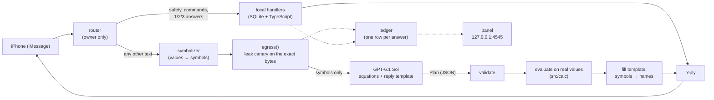

# Private Finance Agent

**Text your finances over iMessage. The cloud model reasons over symbols, and your Mac computes every number.**

You text a number from your phone and get an answer in seconds:

- **Can I afford it?** "Can I buy a $400 jacket?" → "Tight, but doable. You're $155 behind on your $10k June goal, and the $400 would push it to July." Then what would work: anything under $40, or skipping 12 delivery dinners.
- **Goals.** "goal 10000 by june" sets one, and every answer measures against its pace.
- **How long would I last?** "how long would I last if my income stops Jan 1" → months of runway, from savings, checking and the average spend.
- **Who paid on a shared card.** Each charge on a shared card is assigned to you or your partner. When the agent isn't sure, it asks: "Quick one: was that $159 Nordstrom yours? 1 me · 2 her · 3 split".
- **Nudges.** "$449 on office-commute Ubers this month (17 rides). Train 3 days instead and you'd keep about $143." Quiet hours, and at most two a day.
- **Memory.** It remembers what you tell it ("Sephora is always hers", a balance it can't see). `memories` lists them, and `forget N` removes one.
- **Open-ended questions.** "What changed in my spending since August?"
- **Product research.** "Look at its reviews and tell me if it's worth it" runs one web search, carrying only the symbolized question.
- **A privacy ledger.** Text `ledger` to see what left the Mac: "5 questions, 4 never left your Mac, 0 exact values sent."

All numbers in this README come from the synthetic demo dataset (`fixtures/`), not a real account.

## Why it's private

People paste bank statements into chatbots. That sends every merchant, amount and account number to an AI company. This agent never does:

- **The cloud sees symbols only.** Before anything leaves, every value from your data becomes a symbol: `MERCHANT_4`, `PERSON_2`, `Q_AMT_1`. The cloud model, OpenAI's GPT-6.1 Sol, reasons over those symbols and writes placeholder templates such as `{gap}`.
- **The Mac computes.** Real values are filled in on the Mac. Every number in a reply is computed in code, never typed by a model.
- **No model runs on the Mac.** Privacy is plain code: a symbolizer, name rules and a leak canary, all tested.

## Architecture



- **Tier T0, local:** exact commands, who-paid answers, consent replies and the local handlers. Nothing leaves.
- **Tier T2, cloud:** everything else, as symbols, through `egress()`, the only code that reaches a model over the network.
- **No T1:** there's no on-device model. `bin/fm` (Apple Foundation Models) is only an opt-in experiment, `LOCAL_MODELS=on`, and is off by default.

## The privacy locks

1. **Symbolizer** (`src/cloud/symbolize.ts`). Every merchant, amount form, account mask, person, address and memo in SQLite becomes a symbol. An unknown street address becomes `ADDR_n`, and amounts you type become `Q_AMT_n`.
2. **Name rules.** A name the Mac has never seen becomes `PERSON_n` in two cases:
   - It's capitalized (sentence openers too), unless it's a common word, month, weekday, acronym or part of a known merchant.
   - It follows a relationship or money word: "my friend …", "sent …", "owe …", "split it with …".
   People in Venmo and Zelle payments count as known data.
3. **Leak canary over the exact bytes** (`src/cloud/canary.ts`). It scans the serialized request against every real value in many forms: case, spacing, look-alike letters, digits for letters and amount formats. Any hit blocks the call. JSON number literals, which are protocol settings, are skipped.
4. **Consent.** If a plan needs an exact number, you're asked over iMessage. If you say no, the cloud gets a bucket in words ("two hundred fifty to five hundred dollars").
5. **Ledger.** One row per answer records the tier, the symbolized question, the exact payload sent and the canary result. You can view it as the `ledger` text or in the panel.

Your partner's charges are only subtracted. They're never analysed, nudged on or sent anywhere, and questions about her merchants are refused.

## Sol writes the equation, the Mac solves it *(in progress)*

The money path is moving from pattern-matched handlers to one cloud call per message (`tasks/equations.md`). The Mac sends Sol a table of **variable names, units and descriptions, never values**. Sol returns a Plan with actions, facts to store, ordered equations and a reply template. The Mac then validates the Plan, evaluates the equations on real values with a safe parser (`src/calc/expr.ts`: units, PT-calendar dates, limits, no `eval`) and fills the template (`src/calc/render.ts`).

Worked example, with synthetic numbers. "If I quit on Jan 1, how long would my savings last?":

```
now    = SAVINGS + U_CHECKING_NOW                                   // $12,000 + $3,000 = $15,000
jan1   = now + U_OCT_INCOME_LEFT
         + NET_MO * months_between(next_month_start(TODAY), date("2027-01-01"))   // + $2,400 + $1,800 × 2 = $21,000
runway = jan1 / SPEND_MO                                            // usd ÷ usd/mo = months: 7.0
end    = add_months(date("2027-01-01"), runway)                     // early August 2027
reply  = "You'd have about {jan1} on {QUIT|day}. That lasts {runway} months, until {end|when}."
```

The template may contain **no digits, number words or `$` signs**. Every number in the reply comes from a computed value. Units are checked, so `usd + usd_mo` is an error, and so are division by zero, unknown names and expression bombs.

The engine and its tests are in. Wiring it into the router is still in progress. Until then, the existing local handlers answer.

## Data sources

- **Bank:**
  - Plaid (adapter written, not yet run against the live API), or
  - bank statements: Capital One CSV exports, Capital One 360 PDFs and Citi PDFs (`src/ingest/statements.ts`, `seed-real.ts`). Overlapping files are deduplicated and reconciled against the statements' balances.
- **Receipts:** ride and food emails from Gmail over IMAP (`src/ingest/imap.ts`) or the local Apple Mail store.
  - Fixed parsers read totals and pickup/dropoff for Uber, Lyft, Uber Eats and DoorDash.
  - Each address is geofenced to `HOME`/`WORK`/`OTHER` within 250 m, and only the label is used.
- **Demo:** a seeded synthetic 3-month dataset (`fixtures/`, `src/ingest/seed.ts`).

Real data stays in `data/`, which is gitignored and never committed.

**Attribution rules** (`src/attribution/engine.ts`): the first rule that fires assigns the owner.

0. A personal account's charges are yours.
1. A user label wins.
2. Apple Pay on the shared Amex is hers.
3. A HOME↔WORK ride receipt is yours.
4. A single-person food order is yours.
5. A multi-person food order is split.
6. Weekday work hours point to you.
7. Otherwise a default.
8. A standing preference ("Sephora is always hers") is applied after the others and never overrides your labels.

A weak guess over $75 triggers the who-paid question, and your answer becomes a permanent label.

## Quickstart

macOS with Messages, and [Bun](https://bun.sh).

```sh
bun install
cp .env.example .env        # set OWNER_HANDLE (the phone you text from), OPENAI_API_KEY,
                            # OPENAI_MODEL=gpt-6.1-sol, VOICE=cloud, PRIVACY_GATE=off
bun run demo:reset          # seed the synthetic demo DB (data/fin.db)
bun run rehearse            # play every DEMO.md beat on a throwaway DB: must end ALL PASS
bun run src/panel/server.ts # privacy panel at http://127.0.0.1:4545
bun run src/main.ts --live  # the iMessage agent (or --cli to type instead)
```

`bun run demo` does the reset, the panel and the agent in one go. `LLM_PROVIDER=fake` runs everything offline with a canned planner, and nothing is sent anywhere.

## Tests and red team

```sh
bun test                    # 1,103 tests across 41 files, 0 failing
bun test test/redteam.test.ts
```

- **Red team:** an independent red team plus a code review found 34 leaks over six rounds. All are fixed, and the 81 attacks stay in `test/redteam.test.ts`. They run against the exact request body sent to the provider: user-typed values, planner-controlled fields, retries and injections in memos and receipts.
- **Claims and tests:** every privacy claim in `SUBMISSION.md` names the test that proves it.
- **Rehearsal:** `bun run rehearse` checks the stage demo word for word.

## Repo layout

```
src/imessage/    transport, router, commands, consent, safety, memory commands
src/cloud/       symbolize, canary, egress (the only network path), planner DSL, conversation, research
src/calc/        Sol's equations: types, expression evaluator, template renderer
src/handlers/    affordability, goals, runway, spending, attribution fixes
src/ingest/      Plaid, statements, IMAP / Apple Mail receipts, receipt matching, seeds
src/attribution/ who-paid rules
src/nudges/      proactive nudges (quiet hours, daily cap)
src/panel/       the local privacy panel (127.0.0.1:4545)
db/schema.sql    SQLite schema
fixtures/        synthetic demo data
test/            bun tests (all synthetic)
scripts/         demo, reset, rehearse
```

## Honest limits

- **Unflagged names:** a lowercase name the Mac has never seen, with no cue word before it ("lunch with zorya"), goes out as typed. The canary can't block a name it has never seen.
- **Research leaves on purpose:** product research sends brand and model names to a web search.
- **Partial information:** the provider learns the shape of your questions, and bucket words like "tight, behind pace". The ledger counts these as partial disclosures.
- **Unverified integrations:** Apple Pay detection on real Amex data and the live Plaid API are unverified.
- **Evidence, not proof:** passing 81 attacks doesn't rule out an attack nobody tried.

## Credits

See `THIRD_PARTY_NOTICES.md`:

- **CopilotKit/OpenDots (MIT):** the design of the memory store.
- **Laya PII classifier** (goku-san/laya-experts, Apache-2.0; OpenPII data, CC-BY-4.0): an optional local privacy gate, off in this build.
